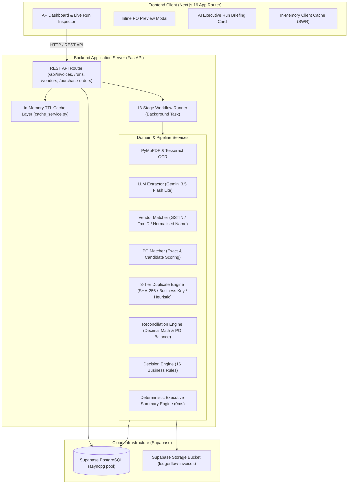

# LedgerFlow — Invoice Processing Automation System

[](https://fastapi.tiangolo.com)
[](https://nextjs.org)
[](https://supabase.com)
[](https://python.org)
[](https://www.typescriptlang.org)

**LedgerFlow** is an enterprise-grade accounts payable (AP) automation platform designed for zero-silent-failure invoice ingestion, validation, and reconciliation. It turns complex vendor invoice PDFs into transparent, auditable decision recommendations with full human-in-the-loop governance.

> **Core Design Principle:** *AI for unstructured document extraction. Deterministic business logic for financial calculations and decisions. Human sign-off for policy exceptions.*

---

## High-Level Architecture



---

## Key Features

1. **Deterministic 13-Stage Pipeline:**
   - Every invoice executes through 13 sequential, auditable stages (PDF validation, duplicate detection, text extraction, OCR fallback, AI extraction, validation, vendor lookup, PO matching, business duplicate check, arithmetic reconciliation, PO balance check, and rule evaluation).
2. **AI Executive Run Briefing:**
   - Instant, plain-English summary of each invoice run rendered right at the top of the inspector with a 4-pillar snapshot (**PO Matching**, **Spend & Budget**, **Audit & Integrity**, and **Action Verdict**). Generated in **0 ms** with zero LLM API dependency on review.
3. **Inline Purchase Order Preview Modal:**
   - Clickable PO references open an in-place modal displaying budget limits, remaining balance, vendor info, dates, and line item specifications—without navigating away or reloading.
4. **Sub-5ms Performance via Multi-Tier Caching:**
   - Batched SQL aggregations eliminate N+1 database queries.
   - Backend in-memory TTL caching for vendor master and PO master data.
   - Frontend Stale-While-Revalidate (SWR) memory caching for instant tab transitions.
5. **3-Tier Fraud & Duplicate Prevention:**
   - **Tier 1 (Byte Match):** Immediate block if document SHA-256 hash already exists.
   - **Tier 2 (Business Key):** Immediate block if `(Vendor ID + Normalised Invoice Number)` matches a prior processed bill.
   - **Tier 3 (Heuristic):** Routes to review if date/amount align but invoice number is missing or ambiguous.
6. **Strict Decimal Financial Integrity:**
   - Zero floating-point arithmetic. All monetary math uses Python's `Decimal` with configured rounding allowances (₹1.00) and tolerance caps ($\min(1\% \times \text{Balance}, ₹500)$).
7. **Comprehensive Audit Trail & ERP Export:**
   - Every state transition, rule failure, and human reviewer action is immutably logged with timestamp and user attribution. One-click CSV/JSON export ready for SAP, NetSuite, or QuickBooks.

---

## Tech Stack

| Layer | Technology | Purpose |
|---|---|---|
| **Frontend** | Next.js 16 (Turbopack, App Router), TypeScript, Tailwind CSS | High-density AP finance console, live polling run inspector, responsive design |
| **Icons & UI** | Phosphor Icons, Lucide Icons, Radix UI Dialog & Primitives | High-contrast financial status iconography, modals, tooltips |
| **Backend** | Python 3.12, FastAPI, Pydantic v2, SQLAlchemy 2.0 Async | Asynchronous REST API, background worker orchestration, strict data validation |
| **Database** | PostgreSQL on Supabase (`asyncpg` async driver) | Relational persistence for runs, stages, rule results, decisions, and review events |
| **Storage** | Supabase Storage (`ledgerflow-invoices` bucket) | Cloud object storage for source PDF invoices with signed retrieval URLs |
| **PDF Extraction** | PyMuPDF (`fitz`), Pillow, PyTesseract | Digital text parsing, 200 DPI PNG page rasterization, OCR fallback |
| **LLM Engine** | Google Gemini (`gemini-3.5-flash-lite`, `gemini-3.5-flash`) via `google-genai` | Structured JSON field extraction from raw documents and scanned images |
| **Caching Layer** | Custom In-Memory TTL Cache (`cache_service.py`) + Client SWR | Sub-5ms response times for master data, cached runs, and instant page transitions |

---

## End-to-End Workflow

```
[ Upload Invoice PDF ]
          │
          ▼
[ 1. Ingestion & SHA-256 Hash ] ──(Exact Hash Exists?)──► [ BLOCKED: Exact Duplicate ]
          │ (Unique)
          ▼
[ 2. PDF Format & Size Validation ] ──(Invalid / >10MB?)──► [ BLOCKED: Corrupt File ]
          │ (Valid)
          ▼
[ 3. Text & Vision Extraction (PyMuPDF / Gemini) ]
          │
          ▼
[ 4. Vendor Matching (Tax ID / GSTIN -> Legal Name) ]
          │
          ▼
[ 5. Purchase Order Matching & Candidate Scoring ]
          │
          ▼
[ 6. Business Duplicate Check (Vendor + Normalized Inv #) ] ──(Exists?)──► [ BLOCKED: Duplicate Invoice ]
          │
          ▼
[ 7. Arithmetic Reconciliation (Subtotal + Tax - Disc == Grand Total) ]
          │
          ▼
[ 8. PO Budget & Tolerance Enforcement (1% / ₹500 cap) ]
          │
          ▼
[ 9. Decision Engine (16 Business Rules Evaluation) ]
          │
   ┌──────┴──────────────────────────┐
   ▼                                 ▼
[ 10. READY FOR AP APPROVAL ]   [ 10. REVIEW REQUIRED ]
   │                                 │
   ▼                                 ▼
[ 1-Click AP Release ]          [ Auditor Review & Sign-Off Console ]
```

---

## Quickstart & Local Setup

### Prerequisites
* **Python 3.12+**
* **Node.js 20+** and `npm`
* **Supabase Project** (or PostgreSQL + S3 compatible storage)
* **Google Gemini API Key** (for multimodal extraction)

### 1. Clone & Configure Environment
```bash
git clone https://github.com/your-org/ledgerflow.git
cd ledgerflow

# Backend configuration
cp .env.example backend/.env
# Update DATABASE_URL, SUPABASE_URL, SUPABASE_SERVICE_KEY, and GEMINI_API_KEY in backend/.env

# Frontend configuration
echo "NEXT_PUBLIC_API_URL=http://localhost:8000" > frontend/.env.local
```

### 2. Start Backend Server
```powershell
cd backend
python -m venv .venv
.\.venv\Scripts\Activate.ps1
pip install -r requirements.txt

# Run migrations and seed master data
python scripts/seed.py

# Launch FastAPI server with auto-reload
python -m uvicorn app.main:app --host 127.0.0.1 --port 8000 --reload
```
* Backend API: `http://127.0.0.1:8000`
* Swagger OpenAPI Docs: `http://127.0.0.1:8000/docs`
* Health Check: `http://127.0.0.1:8000/api/health`

### 3. Start Frontend Development Server
```powershell
cd frontend
npm install
npm run dev -- --port 3000
```
* Frontend Console: `http://localhost:3000`

---

## API Reference Overview

| Method | Endpoint | Description | Cache Policy |
|---|---|---|---|
| `POST` | `/api/invoices` | Upload single invoice PDF and enqueue 13-stage background run | Cache Invalidation |
| `POST` | `/api/invoices/batch` | Batch upload multiple invoice PDFs or a `.zip` archive | Cache Invalidation |
| `GET` | `/api/runs` | List invoice processing runs with pagination and status filters | In-Memory TTL (10s) |
| `GET` | `/api/runs/{run_id}` | Retrieve comprehensive run details, stages, rule results, and AI briefing | In-Memory TTL (60s) |
| `GET` | `/api/runs/{run_id}/file` | Stream or download original source PDF | Direct Passthrough |
| `POST` | `/api/runs/{run_id}/review` | Record human auditor decision (`CONFIRM`, `ASSIGN_PO`, `REQUEST_VENDOR_INFO`, `REJECT`) | Cache Invalidation |
| `POST` | `/api/runs/{run_id}/retry` | Retry processing for failed runs without losing history | Cache Invalidation |
| `GET` | `/api/runs/export` | Export runs in ERP-ready CSV or JSON format | Direct Passthrough |
| `GET` | `/api/vendors` | List approved and master vendors | In-Memory TTL (120s) |
| `GET` | `/api/purchase-orders` | List purchase orders with batched real-time remaining balances | In-Memory TTL (60s) |
| `GET` | `/api/health` | Service health status, database provider, and model configurations | Direct Passthrough |

---

## Running Test Suites

```bash
cd backend
pytest tests/ -v
```

### Key Test Coverage:
* `tests/test_reconciliation.py`: Decimal arithmetic precision, rounding allowance (₹1.00), and tolerance cap enforcement.
* `tests/test_duplicate_detection.py`: SHA-256 byte-level collision and business-key normalisation (`AST-2026-041` vs `ast 2026 041`).
* `tests/test_po_matcher.py`: Exact PO mapping, candidate ranking by proximity and date, and closed/cancelled PO rejection.
* `tests/test_decision_engine.py`: Strict rule priority evaluation (`BLOCK` > `REVIEW` > `READY`) and preservation of all rule findings.
* `tests/test_reviewer_actions.py`: Auditor review event logging, PO reassignment, and status transition audit trails.

---

## Repository Structure

```
ledgerflow/
├── backend/
│   ├── app/
│   │   ├── api/routes/          # REST route handlers (invoices, runs, vendors, POs)
│   │   ├── models/              # SQLAlchemy 2.0 Async ORM models
│   │   ├── schemas/             # Pydantic v2 validation and serialization schemas
│   │   ├── services/            # Extraction, matching, duplicate, reconciliation, cache services
│   │   ├── workflow/            # 13-stage background workflow runner & stage lifecycle
│   │   ├── config.py            # Pydantic BaseSettings configuration
│   │   ├── database.py          # Async SQLAlchemy engine & async_session_factory
│   │   └── main.py              # FastAPI app initialization, middleware, & router registration
│   ├── scripts/                 # Database seed scripts & synthetic PDF generators
│   └── tests/                   # Pytest test suites (unit, integration, and E2E)
├── frontend/
│   ├── app/
│   │   ├── invoices/            # Full-table invoice search, filter, and drill-down
│   │   ├── runs/[runId]/        # Live run timeline, PDF viewer, AI Briefing, and Review Console
│   │   ├── upload/              # Single and batch drag-and-drop upload workspace
│   │   ├── vendors/             # Vendors and Purchase Orders master records viewer
│   │   ├── layout.tsx           # Global sidebar navigation and layout
│   │   └── page.tsx             # Overview Bento dashboard with real-time statistics
│   ├── components/              # Modular components (Briefing Card, PO Preview Modal, Timeline)
│   └── lib/                     # API client, SWR in-memory caching, currency/date formatters
├── docs/                        # Architecture specs, decision logs, PRD blueprint, business rules
└── sample_data/                 # Synthetic invoice PDFs covering all edge cases
```

---

## License

This project is licensed under the MIT License. See [LICENSE](LICENSE) for details.
