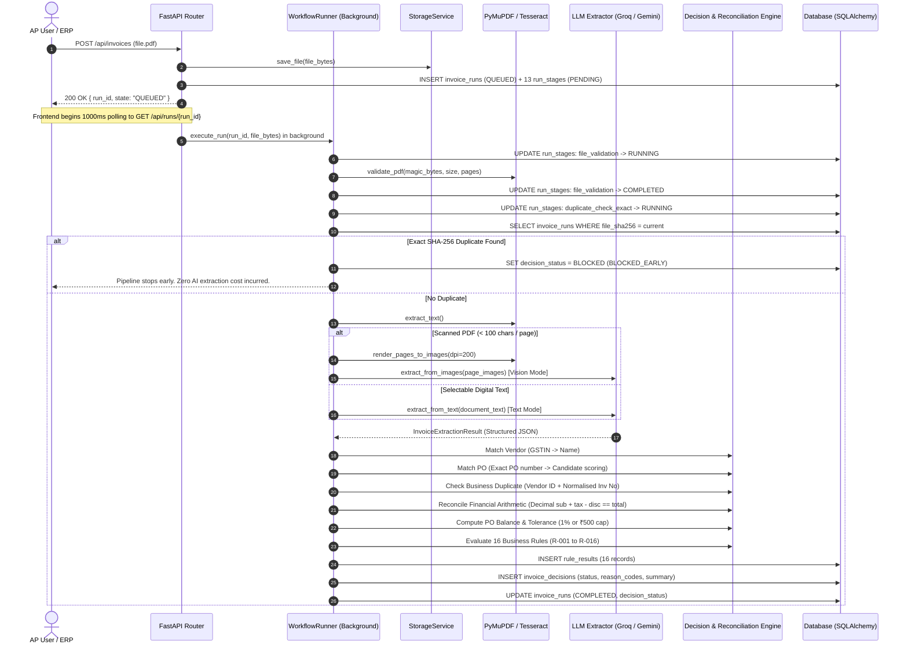
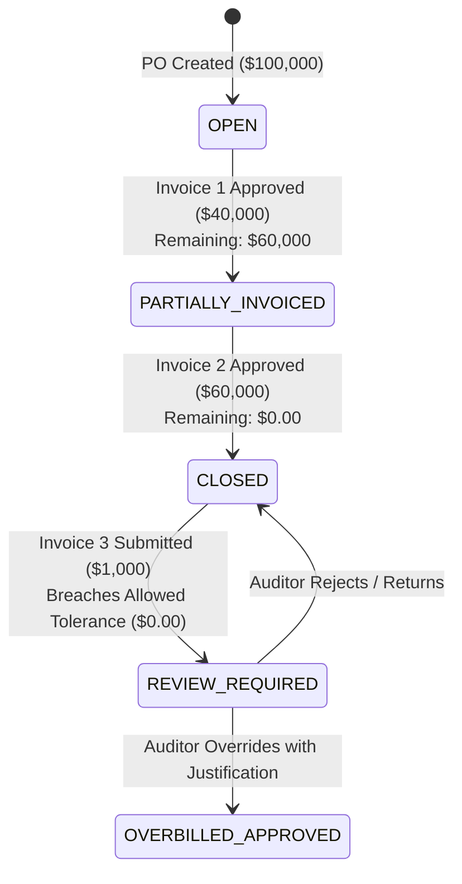

# LedgerFlow — System Architecture & Workflow Specifications

This document outlines the system topology, component interactions, state machine lifecycles, and deterministic boundaries for **LedgerFlow**.

---

## 1. High-Level Architecture Topology

```
┌────────────────────────────────────────────────────────────────────────────────────────┐
│                                CLIENT / BROWSER TIER                                   │
│   Next.js 16 (App Router) • SWR / Polling Timeline • Live Document Viewer • Review UI  │
└───────────────────────────────────────────┬────────────────────────────────────────────┘
                                            │ HTTP / JSON
                                            ▼
┌────────────────────────────────────────────────────────────────────────────────────────┐
│                              FASTAPI APPLICATION SERVER                                │
│                                                                                        │
│  ┌───────────────────────┐  ┌─────────────────────────┐  ┌─────────────────────────┐  │
│  │ REST Routing & Auth   │  │ Background Task Runner  │  │ Storage Service Adapter │  │
│  │ • /api/invoices       │  │ • 13-Stage Pipeline     │  │ • Local File Storage    │  │
│  │ • /api/runs           │  │ • DB Stage Persistence  │  │ • Supabase Storage      │  │
│  │ • /api/vendors        │  │ • Non-blocking Polling  │  │ • AWS S3 / MinIO        │  │
│  │ • /api/purchase-orders│  │                         │  │                         │  │
│  └───────────┬───────────┘  └────────────┬────────────┘  └────────────┬────────────┘  │
│              │                           │                            │               │
│              ▼                           ▼                            ▼               │
│  ┌──────────────────────────────────────────────────────────────────────────────────┐  │
│  │                             CORE DOMAIN SERVICES                                 │  │
│  │  • PDFExtractor: SHA-256 Digest, PyMuPDF selectable text & 200 DPI PNG rendering │  │
│  │  • OCRService: Tesseract fallback for scanned or non-selectable documents        │  │
│  │  • LLMExtractor: Groq Qwen 3.8-27B (Primary) / Gemini 3.8 Flash (Fallback)       │  │
│  │  • DuplicateDetector: 3-Tier duplicate elimination (Byte, Business, Heuristic)   │  │
│  │  • Vendor & POMatcher: Tax ID, GSTIN, normalised string, & candidate PO scoring  │  │
│  │  • ReconciliationEngine: Python Decimal arithmetic, PO balance, 1% tolerance cap │  │
│  │  • DecisionEngine: 16-Rule Deterministic Evaluation (BLOCK > REVIEW > READY)     │  │
│  └───────────────────────────────────────┬──────────────────────────────────────────┘  │
└──────────────────────────────────────────┼─────────────────────────────────────────────┘
                                           │
                                           ▼
┌────────────────────────────────────────────────────────────────────────────────────────┐
│                                  PERSISTENCE LAYER                                     │
│  SQLite (Local Dev) / PostgreSQL (Production) via SQLAlchemy 2.0 Async (aiosqlite/pg)  │
│  • vendors        • purchase_orders  • invoice_runs  • run_stages                      │
│  • rule_results   • invoice_decisions • review_events                                  │
└────────────────────────────────────────────────────────────────────────────────────────┘
```

---

## 2. End-to-End Invoice Processing Sequence



---

## 3. The 13 Pipeline Stages

Every invoice run transitions through the following 13 sequential stages:

| # | Stage Key | Display Name | Responsibility |
| :---: | :--- | :--- | :--- |
| **1** | `file_received` | File Received | Ingestion of raw payload, generation of UUID, and SHA-256 calculation. |
| **2** | `file_validation` | PDF Validated | Header inspection (`%PDF-`), page count limit ($\le 20$), file size limit ($\le 10$ MB). |
| **3** | `duplicate_check_exact` | Exact Duplicate Check | Database lookup for matching `file_sha256`. Early-exit if duplicate detected. |
| **4** | `text_extraction` | Text Extraction | Native text extraction via PyMuPDF. Evaluates character density ($\ge 100$ chars/page). |
| **5** | `ocr_fallback` | OCR / Vision Fallback | Triggered if page text is unreadable or scanned. Renders 200 DPI PNGs for multimodal vision. |
| **6** | `llm_extraction` | AI Field Extraction | Schema-constrained extraction using Qwen 3.8-27B on Groq (fallback to Gemini 3.8 Flash). |
| **7** | `extraction_validation` | Extraction Validation | Validates presence of required fields, date formats, and confidence scores. |
| **8** | `vendor_validation` | Vendor Validation | Two-tier vendor lookup: 1) Tax ID (GSTIN) exact match, 2) Normalised legal name match. |
| **9** | `po_matching` | PO Matching | Exact PO lookup or candidate search by amount proximity and date ranges. |
| **10** | `duplicate_check_business` | Business Duplicate Check | Identifies duplicate billings via `(vendor_id, normalised_invoice_number)` composite key. |
| **11** | `financial_reconciliation` | Financial Reconciliation | Strict decimal validation: $\lvert \text{Declared} - (\text{Subtotal} + \text{Tax} + \text{Shipping} - \text{Discount}) \rvert \le 1.00$. |
| **12** | `po_balance_check` | PO Balance Check | Evaluates remaining balance and enforces policy: $\text{allowed} = \min(1\% \times \text{Balance}, ₹500)$. |
| **13** | `decision_engine` | Decision Generated | Applies 16 deterministic business rules to yield `READY_FOR_AP_APPROVAL`, `REVIEW_REQUIRED`, or `BLOCKED`. |

---

## 4. PO Consumption & Idempotency State Machine



### Idempotency Principles
- **Committed Balance Definition:** A purchase order's consumed balance is calculated via pure SQL aggregation:
  $$\text{Consumed Balance} = \sum_{r \in \text{Runs}} r.\text{grand\_total} \quad \text{where } r.\text{decision\_status} = \text{'READY\_FOR\_AP\_APPROVAL'} \land r.\text{id} \ne \text{current\_run}$$
- **Zero Race Conditions:** During evaluation, the current run's amount is excluded from prior commitments. Once transitioned to `READY_FOR_AP_APPROVAL` or confirmed by an AP auditor, it becomes part of the permanent committed ledger.
