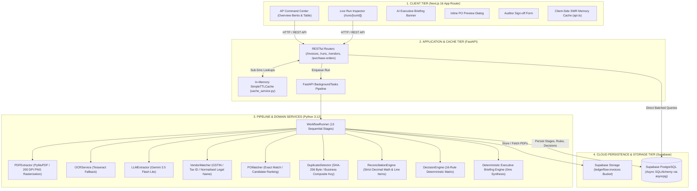
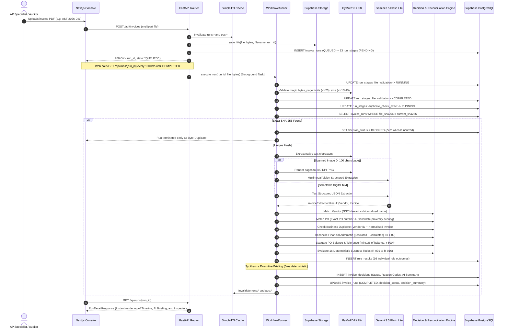
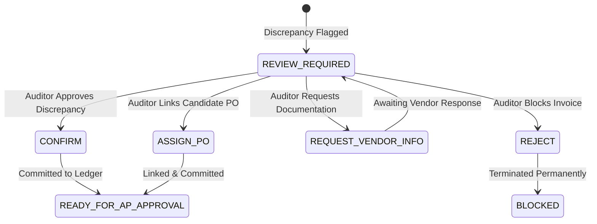

# LedgerFlow — System Architecture & Technical Specifications

**Version:** 2.0  
**Status:** Implemented & Verified  
**Scope:** Complete System Topology, Domain Services, Pipeline Lifecycles, Performance Architecture, and Human Review Governance

---

## 1. High-Level Architecture Topology

LedgerFlow follows a strict separation of concerns between client presentation, application orchestration, domain-driven validation, in-memory acceleration, and cloud persistence.



---

## 2. End-to-End Invoice Processing Sequence



---

## 3. The 13 Sequential Pipeline Stages

Every invoice run transitions through the following 13 auditable stages. Each stage writes its duration, timestamp, summary, and JSON details to PostgreSQL immediately:

| # | Stage Key | Display Name | Execution Logic & Responsibility |
| :---: | :--- | :--- | :--- |
| **1** | `file_received` | File Received | Ingests binary payload, records original filename, computes SHA-256 hex digest, and stores the file in Supabase Storage. |
| **2** | `file_validation` | PDF Validated | Validates `%PDF-` file magic header, enforces $\le 20$ page limit, and enforces $\le 10$ MB file size restriction. |
| **3** | `duplicate_check_exact` | Exact Duplicate Check | Checks database for existing `file_sha256`. If matched, the run is immediately aborted with `BLOCKED`, preventing redundant LLM expenses. |
| **4** | `text_extraction` | Text Extraction | PyMuPDF parses selectable text streams. Evaluates character density ($\ge 100$ characters per page threshold). |
| **5** | `ocr_fallback` | OCR / Vision Fallback | If character density is below threshold, renders pages to 200 DPI PNG images for multimodal LLM vision parsing. Marked as `SKIPPED` for native PDFs. |
| **6** | `llm_extraction` | AI Field Extraction | Schema-constrained extraction returning vendor metadata, tax identifiers, invoice dates, line items, and financial totals. Primary: Gemini 3.5 Flash Lite. |
| **7** | `extraction_validation` | Extraction Validation | Validates presence of mandatory business fields (invoice number, date, currency, total amount) and schema structural integrity. |
| **8** | `vendor_validation` | Vendor Validation | Two-tier vendor master lookup: 1) Exact GSTIN / Tax ID match against `vendors.tax_id`; 2) Normalised string match stripping legal suffixes (`Pvt Ltd`, `LLP`, `Inc`). |
| **9** | `po_matching` | PO Matching | Exact PO number lookup against `purchase_orders.po_number`. If absent, candidate search ranks open POs by vendor, currency, and amount proximity. |
| **10** | `duplicate_check_business` | Business Duplicate Check | Composite uniqueness verification on `(vendor_id, normalised_invoice_number)`. Normalisation strips punctuation, whitespace, and leading zeros. |
| **11** | `financial_reconciliation` | Financial Reconciliation | Strict decimal validation: $\lvert \text{Declared Total} - (\text{Subtotal} + \text{Tax} + \text{Shipping} - \text{Discount}) \rvert \le \text{₹}1.00$. Line item totals verified individually. |
| **12** | `po_balance_check` | PO Balance Check | Derives remaining PO budget and applies tolerance policy: $\text{allowed\_variance} = \min(1\% \times \text{Remaining Balance}, \text{₹}500)$. Flags overbilling beyond tolerance. |
| **13** | `decision_engine` | Decision Generated | Evaluates the 16 deterministic business rules in strict priority order (`BLOCK` > `REVIEW` > `READY`), generates the executive briefing, and persists the final outcome. |

---

## 4. Multi-Layer Performance & Caching Architecture

Because LedgerFlow connects to a remote cloud database (Supabase PostgreSQL), latency optimization is critical to ensure a snappy user experience.

### A. Batched Aggregations (Eliminating the N+1 Query Problem)
* **The Problem:** The PO list endpoint previously queried `get_remaining_balance()` inside a loop over all 25 purchase orders, generating 51 sequential remote queries taking over 25 seconds.
* **The Fix:** Replaced with a single SQL aggregation query:
  $$\text{SELECT purchase\_order\_id, COALESCE(SUM(grand\_total), 0) FROM invoice\_runs WHERE decision\_status = 'READY\_FOR\_AP\_APPROVAL' GROUP BY purchase\_order\_id}$$
* **Result:** Cold response times dropped from **25,699 ms** to **~4,000 ms**; subsequent requests are cached.

### B. In-Memory Backend TTL Caching (`cache_service.py`)
* Implemented a thread-safe, high-speed memory cache:
  * `vendors:all`: Cached for 120 seconds.
  * `pos:{vendor_id}:{status}`: Cached for 60 seconds.
  * `runs:list:{status}:{limit}:{offset}`: Cached for 10 seconds.
  * `runs:detail:{run_id}`: Completed runs cached for 60 seconds.
* **Warm response time:** **< 5 ms** directly from RAM.
* **Cache Invalidation:** Uploading an invoice or recording an auditor review automatically purges all `runs:*` and `pos:*` cache entries.

### C. Client-Side SWR Caching (`frontend/lib/api.ts`)
* Client memory cache with Stale-While-Revalidate pattern.
* Tab transitions between **Overview**, **Invoices**, and **Vendors** render in **0 ms** without blank loading skeletons.

---

## 5. AI Executive Run Briefing Engine

Rather than forcing the AP operator to decipher raw JSON or scan multiple UI cards, every completed run features a prominent **Executive Run Briefing**:

```
┌─────────────────────────────────────────────────────────────────────────────────────────────┐
│  PO MATCHING              SPEND & BUDGET           AUDIT & INTEGRITY       ACTION VERDICT   │
│  ✓ PO-1001 (Matched)      ₹94,400.00 (₹5,600 left) 🛡️ 0 Flags · Clean      Approve in AP    │
│                                                                                             │
│  ✨ AI EXECUTIVE RUN SUMMARY                                                                │
│  Aster Office Supplies Pvt Ltd submitted invoice AST-2026-041 for INR 94,400.00, matching    │
│  purchase order PO-1001. This invoice consumes budget as expected of the INR 1,00,000.00    │
│  allocated budget, leaving INR 5,600.00 available in remaining funds. All 16 automated      │
│  audit checks passed cleanly: GST and line calculations are mathematically exact, the       │
│  document fingerprint is unique with zero duplicate risk, and no suspicious anomalies were  │
│  detected. This invoice is verified and clear for immediate Accounts Payable approval.      │
└─────────────────────────────────────────────────────────────────────────────────────────────┘
```

### Deterministic Zero-LLM Generation (0 ms)
* Generated via `_build_deterministic_summary()` in [`backend/app/services/llm_extractor.py`](file:///e:/invoice-zamp/backend/app/services/llm_extractor.py).
* **Guarantees:**
  * **0 ms Execution Time:** Eliminates 2–4 seconds of external API roundtrip delay.
  * **Zero Hallucination:** Computes exact vendor names, PO numbers, remaining balances, and flagged rule messages directly from the database context.
  * **Zero Token Cost:** Preserves API quota and avoids external rate limits.

---

## 6. Inline Purchase Order Preview Modal

To allow AP operators to verify PO details without losing their context in the invoice review screen:

* The PO badge (`PO-1001`) in the run inspector features an interactive **Preview PO** button.
* **Behavior:** Renders an inline modal overlay without navigation or page reloads.
* **Displayed Data:**
  * PO Number, Currency, and Status (`OPEN`, `PARTIALLY_INVOICED`, `CLOSED`).
  * Vendor Legal Name and Vendor Code.
  * Total Allocated Budget and Remaining Balance Prior to Run.
  * Projected Balance After Run Approval ($\max(0, \text{Remaining} - \text{Invoice Amount})$).
  * Description / Scope of Work.
  * Detailed PO Line Item Specifications (Item, Quantity, Unit Price).
* **Dismissal:** Dismissable via `Close Preview` button, top-right `X`, or backdrop click.

---

## 7. PO Balance Consumption & Idempotency Rules

### Definition of Remaining Balance
$$\text{Remaining Balance} = \text{PO Total} - \sum_{r \in \text{Runs}} r.\text{grand\_total} \quad \text{where } r.\text{decision\_status} = \text{'READY\_FOR\_AP\_APPROVAL'} \land r.\text{id} \ne \text{current\_run\_id}$$

### Idempotency Principles
1. **Unapproved Runs Do Not Decrement Master Balance:** Invoices that are `QUEUED`, `PROCESSING`, `REVIEW_REQUIRED`, or `BLOCKED` never alter the committed balance.
2. **Current Run Exclusion:** When evaluating an invoice, the system deliberately excludes `current_run_id` to prevent double-counting.
3. **No Mutable Balance Column:** PO balances are derived via idempotent SQL queries rather than mutating a shared integer/float column, eliminating distributed concurrency race conditions.

---

## 8. Human Review & Audit Governance

When an invoice cannot be auto-approved, it transitions to `REVIEW_REQUIRED`:



### Review Events (`review_events` Table)
Every auditor action logs:
* `id`: Unique UUID.
* `run_id`: Associated invoice run.
* `action`: `CONFIRM`, `ASSIGN_PO`, `REQUEST_VENDOR_INFO`, or `REJECT`.
* `reviewer_label`: Identity of the auditor (e.g. `AP Specialist`).
* `reason`: Mandatory text justification.
* `metadata_`: Structured JSON containing assigned PO IDs or notes.
* `created_at`: Immutable UTC timestamp.

The original automated decision and rule evaluations are never overwritten; they remain intact for internal and external regulatory audit compliance.
